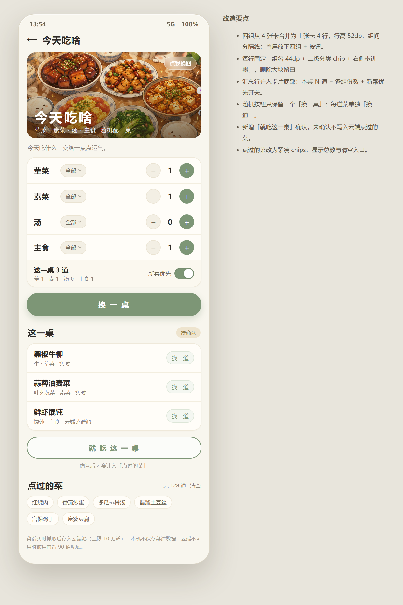

# S520J · 只属于两个人的共同生活记录 App

> 面向情侣两人的私密 Android 应用：把日常互动、照片回忆、纪念日与「今天吃啥」集中在一处，双端自动同步。
> 不上架应用商店，只在自己与对方的两台手机上运行。

| 项目 | 说明 |
| --- | --- |
| 平台 | Android 8.0+（minSdk 26 / targetSdk 35） |
| 客户端 | Kotlin + Jetpack Compose + Material3 + Room + Hilt |
| 云端 | 腾讯云开发 CloudBase（Node.js 20 云函数 + PostgreSQL） |
| 当前版本 | v1.2.3（versionCode 1203，Debug 签名） |
| 安装包 | [`dist/S520J-v1.2.3-debug.apk`](dist/S520J-v1.2.3-debug.apk)（约 22 MB） |

---

## 一、作品简介

两个人的生活记录通常散落在聊天记录、相册、备忘录和外卖软件里：换手机就丢、找一张照片要翻很久、"今天吃什么"每天都要重新商量一遍。

S520J 把这件事收进一个只有两个人能进的空间：

- **四个固定主页面**：心动（今日互动与计划）、拾光（照片与生活）、默契（重要日子与承诺）、我们（资料与设置）
- **云端为权威源，本地负责离线**：一端写入，另一端在 20 秒内看到
- **可见范围只有两档**：仅自己（private）/ 两个人（couple），服务端逐请求二次校验



---

## 二、亮点功能

### 1. 今天吃啥：一次点击凑一桌菜

选好荤 / 素 / 汤 / 主食各几道，一次生成一桌菜，并自动避开最近点过的。

- 四级降级：第三方菜谱接口实时抽取 → 云端菜品池 → 本机快照 → 内置 90 道，**断网或额度用尽也不会卡住**
- 每日配额 100 次 + 保底 20 次，用单条 `INSERT ... ON CONFLICT ... WHERE used + n <= limit` 原子扣减，并发不超发
- 每次点菜顺带把整页菜品入库，每日 03:30 定时增量同步；池子上限 10 万条，按最久未出现淘汰
- 分类按菜谱标签映射（荤 / 素 / 汤 / 主食），不靠菜名猜，冲突优先级 `汤 > 荤 > 素 > 主食`

### 2. 双人同步与冲突合流

- 本地 Room 为权威写入 + outbox 队列，联网后按序推送；前台 20 秒轮询 + WorkManager 15 分钟周期同步
- 服务端以 `baseVersion` 做乐观锁：版本不一致时写入冲突快照并回传服务端版本，由用户在「保留本机 / 采用云端」中二选一，**不静默覆盖**
- 图片压缩至最长边 ≤1600px、≤250KB 后上传，客户端只交换云端 `assetId`，本机路径不出网

### 3. 共同空间的完整生命周期

创建 → 6 位绑定码（24h 有效、去易混字符）→ **双向确认**绑定 → 解绑申请 → 双方确认后冻结为只读 → 重绑复活。
解绑、删除等影响双方的操作都需要对方确认，单方无法改变共同状态。

### 4. 四人以下规模也能优雅降级

- 不接第三方推送：前台轮询 + 本地通知，事件按 `对象 + 状态版本 + 接收者` 幂等去重
- 通知中心首次拉取只归档历史、不刷屏；心愿四类动态（提出/答应/拒绝/实现）只通知另一方
- 回收站 30 天软删，双方内容彻底删除需双人确认

---

## 三、评委体验

### 安装

1. 下载 [`dist/S520J-v1.2.3-debug.apk`](dist/S520J-v1.2.3-debug.apk)
2. 传到 Android 手机（微信 / QQ 发送文件均可）
3. 点击安装，允许「安装未知应用」后继续
4. 打开「S520J」

### 测试账号

| 账号 | 密码 |
| --- | --- |
| `12345678` | `12345678` |

该账号已在一个已绑定的双人空间中（邀请码无需使用），登录后四页均有同步好的内容：照片 5 条、心愿 3 条、情书 2 封。
建议允许通知权限，才能看到双人互动产生的系统通知。

### 建议体验路径（3–5 分钟）

1. **心动**：今日挑战（标记完成）→ 心愿卡（答应 / 拒绝）→ 碰碰你 → 快速记录 5 个入口 → 共同日历
2. **拾光**：点「共同照片」卡进入照片总览，点任意照片放大、翻页 → 五星榜 → 右下角「+」新增记录
3. **今天吃啥**：选荤 / 素 / 汤 / 主食份数与口味分类 → 生成一桌菜
4. **默契**：横滑模块 →「一封情书」→ 查看全部（按「写给 TA / 来自 TA」筛选）→ 相处之道（双方确认）
5. **我们**：资料卡 → 共同空间 → 通知中心 → 隐私与权限 → 数据管理（回收站 / ZIP 导出）

> 双人互动（对方回执、解绑确认）需要另一端触发，单人体验时只会看到自己这一侧的结果，属设计预期。

---

## 四、技术架构

```
Compose UI（19 条路由 / 4 个主页面）
        │  StateFlow / Channel
   AppViewModel（单一全局 VM）
        │
   domain 纯规则（food / heart / tacit / us / gallery，无 Android 依赖）
        │
   repository（本地 Room 权威写入 + outbox）
        │
   HTTPS  /api/<group>  →  { action, payload, token }
        │
CloudBase 云函数（前缀路由 → handlers → exec-pgsql）
        │
PostgreSQL（17 张表，RLS 拒绝直连，仅服务端代理访问）
```

| 层 | 选型 |
| --- | --- |
| UI | Jetpack Compose、Material3 自定义主题、Navigation Compose、Coil |
| 本地 | Room（v7，9 实体 / 7 DAO）、DataStore |
| 依赖注入 / 异步 | Hilt、Kotlin Coroutines、WorkManager |
| 网络 / 序列化 | Retrofit、kotlinx.serialization、OkHttp |
| 云端 | CloudBase 云函数（Node.js 20）、PostgreSQL、网关 `exec-pgsql` |
| 测试 | JUnit + MockK（302 个 JVM 用例）、`node --test`（30 个云端规则用例） |

**云端接口分组**：`auth` / `space` / `content` / `sync` / `media` / `recycle` / `notification` / `settings` / `backup` / `dishSync`，入口按 action 前缀统一路由。

---

## 五、目录结构

```
app/src/main/java/com/s520j/app/
  ui/            Compose 页面、组件、主题、导航、AppViewModel
  domain/        纯业务规则（心愿状态机、菜品分类、照片流、默契模块）
  data/local/    Room 实体、DAO、数据库
  data/cloud/    云端接口（认证、空间、点菜）
  data/sync/     同步、冲突、回收站
  data/media/    图片压缩与缓存
cloudbase/
  functions/     云函数源码（_shared 为唯一真源）
  db/            001~006 增量 SQL（幂等）
  scripts/       部署前分发、SQL 执行、配置生成
docs/            交付说明、运维手册、视觉稿
.trae/specs/     规格驱动开发记录（spec / tasks / checklist）
dist/            APK 与构建信息
```

---

## 六、本地构建

环境：JDK 17、Android SDK（platform 35、buildTools 36.0.0）。

```powershell
# 单元测试
.\gradlew.bat testDebugUnitTest

# 出包
.\gradlew.bat assembleDebug -Ps520jVersionName=v1.2.3 -Ps520jVersionCode=1203

# 一键出包（含包信息校验，产物写入 dist/）
powershell -ExecutionPolicy Bypass -File scripts\build_apk.ps1 -Tag v1.2.3
```

云端部署（需要自备 CloudBase 环境与密钥，见 [docs/运维手册.md](docs/运维手册.md)）：

```powershell
node cloudbase\scripts\prepare-functions.js        # 分发 _shared 到各函数目录
node cloudbase\scripts\run-sql.js cloudbase\db\001_schema.sql
# 依次执行 002_rls、003_couple_live、004_media_sync、006_dish_pool
```

---

## 七、设计规范

| 用途 | 色值 |
| --- | --- |
| 页面背景 | `#F8F6EE` 暖白 |
| 卡片背景 | `#FFFEFA` 柔和白 |
| 主色 | `#7D9676` 鼠尾草绿 |
| 浅绿 / 沙色 | `#D9E5D2` / `#EEE4CE` |
| 主要 / 次要文字 | `#344033` / `#858778` |
| 分割线 | `#E8E2D5` |

完整规范见 [前端外观设计需求文档.txt](前端外观设计需求文档.txt) 与 [S520J_Android_技术实现需求文档_v1.0.md](S520J_Android_技术实现需求文档_v1.0.md)。

---

## 八、已知约束

诚实说明当前边界：

- 环境未开通对象存储，图片以 ≤250KB base64 存入 PG 的 `media_blobs`，放大图清晰度受限；切换对象存储只需替换 `media.upload` / `media.fetch`
- 网关单次 SQL 执行上限约 8 秒、单条语句，因此大对象写入受限，服务端没有真事务，多步写操作存在半写风险
- 未接系统推送：APP 完全退出后不保证事件即时到达
- 手机号验证码登录、本机偏好云端同步为后续规划，当前不提供入口
- 仓库中的 APK 为 Debug 签名，仅用于体验安装，未做混淆与正式签名

---

## 九、开发过程

- **规格驱动**：8 套变更规格（`.trae/specs/`），每套含 Why / What Changes / Impact / 场景 / tasks / checklist，共 300 多个可勾选任务
- **真机验收**：34 个阶段 APK（v0.1.4 → v6.4.0），每阶段双机验收后打 tag
- **自动化**：302 个 JVM 单元测试 + 30 个云端业务规则用例（分类映射、配额并发、降级链、通知幂等）

---

## 十、文档索引

| 文档 | 内容 |
| --- | --- |
| [S520J_Android_技术实现需求文档_v1.0.md](S520J_Android_技术实现需求文档_v1.0.md) | 功能、数据模型、权限矩阵、同步规则、API、验收要点 |
| [前端外观设计需求文档.txt](前端外观设计需求文档.txt) | 色板、字号、卡片、四页交互规范 |
| [docs/交付说明.md](docs/交付说明.md) | 架构、部署顺序、图片同步方案 |
| [docs/运维手册.md](docs/运维手册.md) | 环境配置、备份恢复、提醒机制、发布流程 |
| [docs/mockups/gallery-today-eat-what.html](docs/mockups/gallery-today-eat-what.html) | 点菜页交互视觉稿（浏览器直接打开） |
